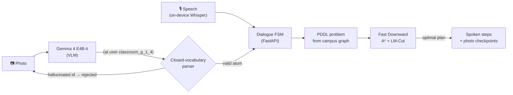
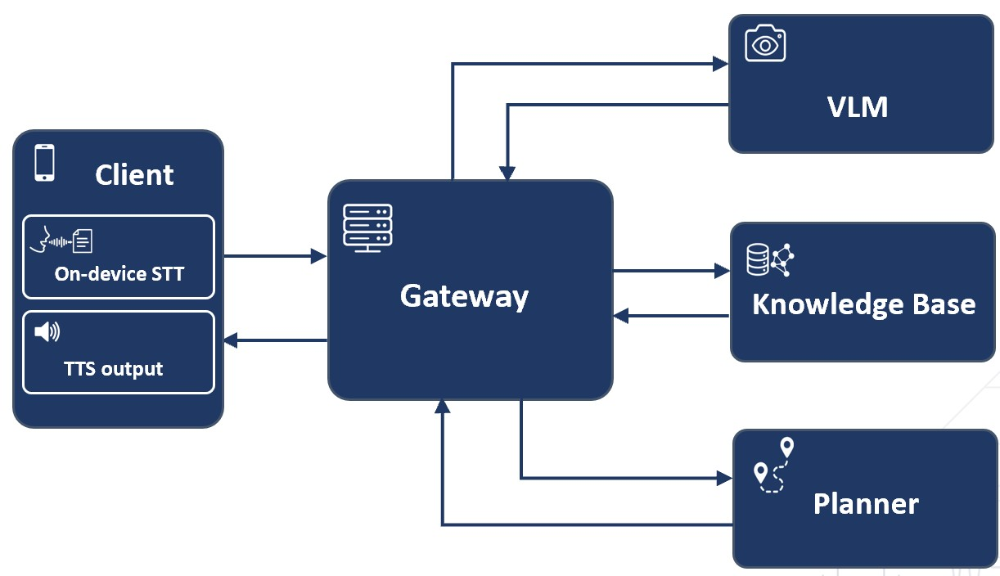

<div align="center">

# VisionLeader

**Neuro-symbolic indoor navigation for visually impaired users**

Speak a destination. VisionLeader reads the campus around you and guides you there, door to door, with a provably optimal route.

[](https://github.com/albertogomezsoteres/visionleader/actions/workflows/ci.yml)

-02569B?logo=flutter&logoColor=white)

[](LICENSE)

🏆 **Bachelor's thesis graded 10/10 with *Matrícula de Honor***, the highest distinction in the Spanish university system<br>
B.Sc. in Computer Engineering · Universidad Francisco de Vitoria, Madrid · 2026

</div>

---

## Overview

Finding a classroom in an unfamiliar building is hard without sight: signs are
visual, the layout is unknown, and generic navigation apps stop at the front door.
VisionLeader is a voice-first assistant for the Universidad Francisco de Vitoria
campus. A blind or low-vision student asks for a room, and the system:

1. **listens on the device:** Whisper transcribes speech offline, so the voice never leaves the phone;
2. **reads the surroundings:** a vision-language model turns a photo of a room plate, a directory sign or an elevator into a symbolic fact such as `(at user classroom_g_1_4)`;
3. **plans:** the Fast Downward classical planner computes the cheapest route over a PDDL model of the campus, across floors, elevators, stairs and buildings;
4. **guides:** the plan is compressed into a few spoken steps, and each critical step is verified with a photo before moving on.

## Why neuro-symbolic

Neural models are good at the messy inputs (accented speech, blurry signage) but
cannot guarantee anything about a route. A classical planner guarantees optimality
and completeness but cannot read a photo. VisionLeader uses each where it is
strong, and the interface between them is deliberately narrow: **the model has to
commit to a single atom from a closed vocabulary**, which the system either accepts
or rejects. It is never asked to describe a route.



Two properties follow:

- **Optimal routes.** A* with the admissible LM-Cut heuristic returns the minimum-cost
  plan under the campus distance model.
- **Live adaptation without retraining.** Room availability is part of the planning
  state, so closing an elevator (`scripts/close_room.py`) reroutes the next request
  immediately, with no restart.

<p align="center"></p>

## Results

Every component was chosen through its own experiment on a purpose-built campus
dataset, and the assembled system was then validated end to end.

| Component | Choice | Key evidence |
|-|-|-|
| **Speech to text** | Whisper tiny q5_0, on device | 100% domain-keyword accuracy on 30 campus utterances; 0.28% WER and ~3.1 s per utterance on a Pixel 10 Pro, in a 28.5 MB model. All 6 Whisper sizes hit 100% keyword accuracy against 54 to 56% for the two non-Whisper baselines. |
| **Vision-language model** | Gemma 4 E4B-it | Tied first of 7 models on element and state recognition (0.96). Best at reading locations: **1.00** vs 0.74 for PaliGemma 2 3B. |
| **Symbolic grounding** | Optimized prompts | Exact PDDL-atom match **0.20 → 0.84** from text and **0.35 → 0.96** from images. |
| **Planner** | A* + LM-Cut | Optimal on 12/12 routes while expanding **75× fewer states** than blind A* (125 vs 9,433). Greedy search returns a costlier route on 4 of 12. |
| **End to end** | Full system | **3/3** scenarios door to door, **14/14** validation checks; 22 planner actions narrated as 7 spoken steps; 3.6 s mean latency per turn. |

Details and protocols: [`docs/experiments.md`](docs/experiments.md) and the README in each
[`experiments/`](experiments/) folder. These figures are not just copied into the
docs: [`tests/test_data_and_results.py`](tests/test_data_and_results.py) recomputes
each of them from the committed result CSVs.

## What a route sounds like

A real session through the dialogue agent: the user starts at entrance 2 of building
G and asks for classroom 1.4, one floor up.

```text
👤  "I am at entrance 2 of building G"
🔊  Got it: entrance 2, in Building G. Where do you want to go?
👤  "Take me to classroom 1.4"
🔊  Route to Classroom 1.4, in Building G. Uses the elevator.
    Go to the elevator. Photograph the elevator.
📷  elevator_state → {"type": "elevator", "detail": "open"}
🔊  Confirmed. Use the elevator, then turn left, walk 10 meters;
    classroom 1.4 is on your left. Photograph to verify.
📷  room_plate → (at user classroom_g_1_3)
🔊  I expected classroom 1.4, but I see 1.3. Retake the photo.
📷  room_plate → (at user classroom_g_1_4)
🔊  You have arrived at Classroom 1.4, in Building G. Want to go somewhere else?
```

Behind it, Fast Downward returned a 6-action plan of cost 33
(`walk → verify_elevator → use_elevator → walk ×3`), which the agent merged into two
spoken steps. This exact exchange runs as a test in
[`tests/test_conversation_agent.py`](tests/test_conversation_agent.py).

## Quickstart

Requirements: Python 3.10+, [uv](https://docs.astral.sh/uv/), and Docker for the planner.

```bash
git clone https://github.com/albertogomezsoteres/visionleader.git
cd visionleader
make install          # exact environment from uv.lock + pre-commit hooks
make test             # 134 tests, no Docker or GPU needed
make planner-image    # build Fast Downward (pinned release) once
cp .env.example .env  # Colab tunnel URL and Maps key, see docs/setup.md
make serve            # API on http://localhost:8000 · OpenAPI docs at /docs
```

Ask for a route straight away, no phone needed:

```bash
curl -s localhost:8000/api/plan -H 'Content-Type: application/json' -d '{
  "initial_state": {"building": 1, "floor": 0, "room": "entrance_2"},
  "goal_state":    {"building": 1, "floor": 1, "room": "classroom_g_1_4"}
}'
```

The vision model is served from a Colab GPU ([`deploy/`](deploy/)) and the Flutter
client lives in [`mobile_app/`](mobile_app/). Full setup:
[`docs/setup.md`](docs/setup.md). Run `make help` for every target.

## Reproducibility

| What | How it is pinned | How to check |
|-|-|-|
| Python environment | `uv.lock` (every transitive version) | `make install` |
| Planner | Fast Downward `release-24.06.1`, two-stage Docker build | `make test-planner` re-solves all 36 benchmark runs and requires **identical** cost, plan length and expanded, generated and evaluated states |
| Model inference | Greedy decoding, fixed seeds, one reproducibility card per experiment (environment, hardware, input hashes) | [`docs/reproducibility.md`](docs/reproducibility.md) |
| Datasets | Manifest + SHA-256 for every file; private media (voice, campus photos) never committed | `tests/test_data_and_results.py` |

CI runs lint, the test suite on Python 3.10 to 3.12, and the planner reproduction
inside the pinned image on every push.

## Repository layout

```text
visionleader/
├── src/visionleader/        Python backend (installable package)
│   ├── api/                 FastAPI app: planning, conversation, image and GPS routes
│   └── navigation/          dialogue FSM, PDDL problem generator, Fast Downward client
├── mobile_app/              Flutter client (Android): voice, camera, TTS, on-device Whisper
├── pddl/                    planning domain + the 12 frozen benchmark problems
├── config/                  campus topology, places, closures, VLM prompt catalogue
├── experiments/             one folder per experiment: code, notebooks, results CSVs
├── data/                    test-set manifests and SHA-256 hashes (media kept private)
├── deploy/                  Colab notebook serving Gemma 4 E4B-it over a tunnel
├── docker/fast-downward/    pinned planner image
├── scripts/                 start/stop the API, close or open rooms, rebuild topology
├── tests/                   unit, dialogue, API, data and planner-reproduction tests
└── docs/                    architecture, setup, experiments, data, reproducibility
```

## Documentation

- [Architecture](docs/architecture.md): components and the per-turn flow
- [Setup](docs/setup.md): backend, vision model, planner, mobile app and tests
- [Experiments](docs/experiments.md): how each component was selected
- [Data](docs/data.md): test sets and what stays private
- [Reproducibility](docs/reproducibility.md): seeds, hardware and how to rerun
- [PDDL model](pddl/README.md) · [Configuration](config/README.md) · [Mobile app](mobile_app/README.md)

## Citation

```bibtex
@thesis{gomezsoteres2026visionleader,
  author = {Gomez Soteres, Alberto},
  title  = {VisionLeader: Neuro-Symbolic Campus Navigation for Visually Impaired Users},
  type   = {Bachelor's thesis},
  school = {Universidad Francisco de Vitoria},
  year   = {2026},
  note   = {Graded 10/10 with Matrícula de Honor}
}
```

## License

[MIT](LICENSE) © 2026 Alberto Gomez Soteres
