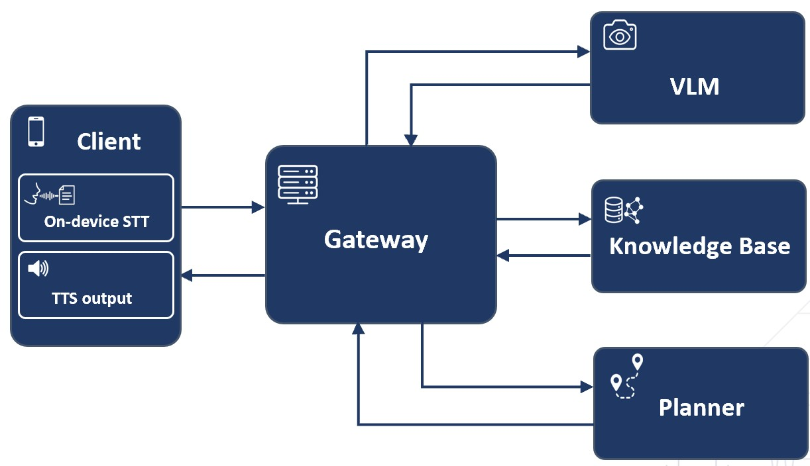

# Architecture

VisionLeader UFV is a neuro-symbolic indoor navigation assistant. Neural models
handle the unstructured inputs (speech and photos); a symbolic planner handles the
reasoning (the route). The link between the two is structured text: the vision model
emits PDDL atoms that the planner can act on.

## Components

| Component | What it does | Technology | Where it runs |
|-|-|-|-|
| Mobile app | Records voice, takes photos, speaks directions | Flutter (Android) | The phone |
| Speech to text | Transcribes the user's voice | Whisper tiny q5_0 (whisper.cpp) | The phone |
| Backend | Orchestrates the dialogue, builds planning problems, narrates routes | FastAPI (Python) | A server |
| Vision model | Reads campus signs and doors into structured facts | Gemma 4 E4B-it | Colab GPU |
| Planner | Computes the optimal route | Fast Downward (A* with LM-Cut) | Docker |
| Knowledge | The campus graph and the planning rules | PDDL domain + JSON topology | Loaded by the backend |

### Mobile app

The Flutter client (Android) is the only part the user touches. It records audio and
transcribes it on the device with Whisper, sends the text to the backend, takes a
photo when the backend asks for one, and speaks the backend's replies through
text-to-speech.

### Backend

The FastAPI backend is the orchestrator. It keeps the conversation state, decides
what to do on each turn (ask for a photo, plan a route, give the next step), builds
the planning problem from the campus graph, and turns the resulting plan into spoken
instructions.

### Vision model

Gemma 4 E4B-it reads a campus photo into a structured fact: a room plate or
directory sign becomes a PDDL atom such as `(at user classroom_g_1_4)`, and an
elevator or staircase becomes a state value. It needs a GPU, so it runs on Colab and
the backend calls it over an HTTP tunnel.

### Speech to text

Whisper (tiny, q5_0) runs on the phone through whisper.cpp, so transcription works
without the network and keeps the user's voice on the device.

### Planner and knowledge

The route is computed by Fast Downward with A* and the LM-Cut heuristic, which
returns an optimal path. The planning rules live in `pddl/domain.pddl` (the actions
and their costs) and the campus graph in `config/campus_topology.json` (rooms, edges
and distances). The backend builds a fresh PDDL problem for each request and solves
it in a Docker container.

## One turn, end to end

1. The phone records the voice and transcribes it on the device (Whisper).
2. It sends the text to the backend, which updates the dialogue and chooses the next action.
3. If a photo is needed, the phone sends it to the vision model, which returns a PDDL atom or a state value.
4. The backend builds a PDDL problem from the campus graph and solves it with Fast Downward for an optimal route.
5. The route becomes spoken, step-by-step directions, played on the phone.

## Code map

| Concern | Module |
|-|-|
| HTTP routes | `src/visionleader/api/routers/` (`plan`, `conversation`, `image`, `gps`) |
| VLM prompt catalogue and response grounding | `src/visionleader/api/services/vlm_prompts.py` |
| Call to the Colab VLM | `src/visionleader/api/services/image_analysis.py` |
| Dialogue state machine | `src/visionleader/navigation/conversation_agent.py` and `navigation/agent/state_handlers/` |
| Utterance parsing (origin, destination, yes/no) | `src/visionleader/navigation/agent/parsing.py` |
| Campus graph to PDDL problem | `src/visionleader/navigation/hierarchical_pddl_converter.py` |
| Fast Downward in Docker | `src/visionleader/navigation/fast_downward_client.py` |
| Plan to spoken steps | `src/visionleader/navigation/agent/plan_to_steps.py` |
| Structured telemetry (used by the end-to-end validation) | `src/visionleader/api/telemetry.py` |
| Repository paths (`VISIONLEADER_ROOT`) | `src/visionleader/paths.py` |
